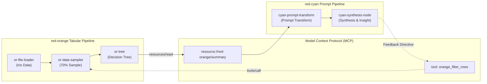

# Red-Cyan Semantic Prompt & Agent Pack Integration

## 1. Overview

`red-orange` has expanded its visual dataflow capabilities beyond classical tabular data mining and ML models by integrating **`red-cyan`**'s semantic prompt transformation and agent node pack directly into the shared **React Flow** canvas.

This delivers a unified **Neuro-Symbolic Natural Language Processing Platform**:
- Quantitative nodes (`OR Data`, `OR Transform`, `OR Model`) process numerical datasets and compute statistical distributions, cluster assignments, and predictive scores.
- Semantic nodes (`Cyan Prompt`) consume tabular metrics and feature summaries, executing LLM-driven prompt transformations to generate natural language explanations and hypotheses.
- **MCP Bridge**: Connects data mining workflows with agent reasoning via standardized Model Context Protocol (MCP) resources and tools.



---

## 2. Integrated Palette & Catalog Specification

The node catalog (`src/flow/catalog.ts`) now includes the official **"Cyan Prompt"** category with accent color `#06B6D4`:

| Node Type | Category | Inputs | Outputs | Description |
| :--- | :--- | :--- | :--- | :--- |
| `cyan-prompt-transform` | Cyan Prompt | Dynamic | 1 | Executes LLM prompt transformations with live token preview. |
| `cyan-tabular-context` | Cyan Prompt | 1 | 1 | Serializes upstream tabular DataFrames into LLM prompt context. |
| `cyan-synthesis-node` | Cyan Prompt | 1 | 0 | Synthesizes multi-node inputs into knowledge base artifacts. |

---

## 3. Dynamic React Flow Node: `CyanPromptNode`

Unlike standard static nodes, `CyanPromptNode` (`src/flow/CyanPromptNode.tsx`) features dynamic reactivity:

1. **Reactive Handle Inferrer (`cyanViewModel.ts`)**:
   - Parses the Jinja2 prompt template in real time for `{{ inputs.<variable> }}`.
   - Automatically computes vertical handle positions and mounts labeled target handles (`in-<variable>`) along the left edge.
2. **In-Canvas Template Editor**:
   - Allows on-the-fly editing of prompt instructions, model parameters (`gpt-4o`, `claude-3-5`), and temperature.
3. **Real-time Output Preview**:
   - Displays streaming output text and markdown summaries directly on the canvas surface.
4. **Static & Dynamic Attribute Chips**:
   - Visual badges for static tags (`#churn`, `#finance`) and dynamic inference properties (`sentiment: negative`).

---

## 4. Drag-and-Drop & Type Contracts

- **Drag & Drop**: `instantiateDroppedNode` in `paletteDnd.ts` checks `category === "Cyan Prompt"` and instantiates a `cyanPromptNode` on drop.
- **Data Contracts**: `types.ts` defines `SemanticPayload` and `NodeAttributeSet`, ensuring cross-node contract fidelity across wires.

---

## 5. Model Context Protocol (MCP) Bridge & Feedback Loop

With Phase 3 implemented, communication between quantitative `red-orange` nodes and semantic `red-cyan` agent nodes operates over standard MCP:

1. **Tabular MCP Resources (`resources/list`, `resources/read`)**:
   - `red-orange` statistical summaries and data profiling schemas are registered as MCP resources:
     `resource://red-orange/datasets/{dataset_id}/summary`
   - Downstream prompt nodes can inspect schema definitions, distributions, and model performance metrics via standard resource reads without blowing LLM context windows.
2. **Quantitative MCP Tools (`tools/list`, `tools/call`)**:
   - Quantitative operations (e.g. data filtering, sampling, k-means clustering) are registered as callable MCP tools.
3. **Agentic Feedback Loop (`McpBridgeClient`)**:
   - `src/flow/mcpBridgeClient.ts` provides a high-level client for frontend nodes:
     ```ts
     const bridge = new McpBridgeClient();
     // Discover available tabular profiles
     const resources = await bridge.listResources();
     const profile = await bridge.readResource(resources[0].uri);

     // Agent node issues feedback directive back to orange data pipeline
     await bridge.callTool("orange_filter_rows", { column: "petal_length", threshold: 2.0 });
     ```
   - This allows reasoning LLM nodes to reactively adapt and steer upstream data mining workflows.

